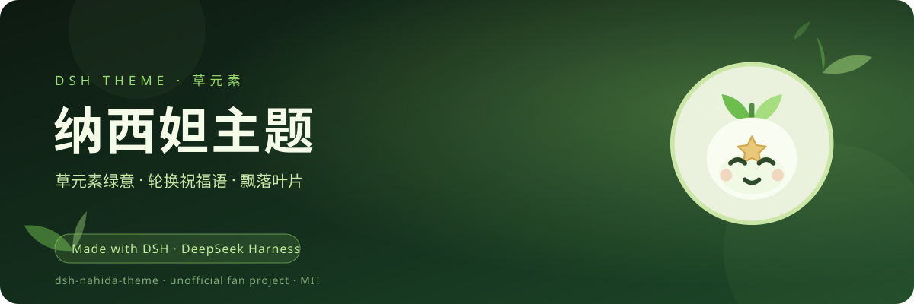

# dsh-nahida-theme · 纳西妲主题

[](LICENSE)
[](https://www.npmjs.com/package/dsh-nahida-theme)
[](https://github.com/OrphBladean/dsh-nahida-theme)
[](https://github.com/deepseek-ai/dsh)
[](https://github.com/deepseek-ai/dsh)



把 DSH Web GUI 换成《原神》纳西妲（Nahida）的草元素绿意主题：侧边栏与欢迎页的小鱼换成四叶草，主色、画布与侧边栏换成草元素配色，输入框下方多一句轮换的祝福语，框架里飘着几片半透明的草叶；还可以在「设置 → 纳西妲主题」里给聊天区挑一张壁纸（15 张随包附带），聊天页右下角的四叶草按钮也能打开同一个设置页。聊天卡片与输入框是单色透明的浅绿面板（无毛玻璃、无边框、无辉光），中间只留一枚很淡的四叶印，文字用深绿，输入光标是 DOS 式绿色短横线。全部是 CSS 变量与插槽渲染，不改宿主布局、不碰其他插件的 DOM，卸载即还原。

> **English** — A dendro-green Nahida skin for the DSH Web GUI: a small alias-token layer over the active light/dark theme, an original four-leaf-clover brand mark, a rotating localized blessing line below the composer, click-through drifting leaves, 15 selectable chat wallpapers under **Settings → Nahida theme** (the clover button at the chat's bottom-right opens the same page), and chat cards/composer turned into flat translucent green panes with a faint four-leaf-clover watermark — no blur, no border, no glow — dark-green ink, and a DOS-style green underscore caret. Theme-token overrides only; uninstalling restores everything.
>
> Install (npm): `dsh plugin --profile web add dsh-nahida-theme` — or from GitHub: `dsh plugin --profile web add github:OrphBladean/dsh-nahida-theme`. Reload the page afterwards. UI text follows the DSH locale (zh / en / ja).

> **Made with DSH · 由 DSH 制作**
> 这个插件的代码、文案、原创图标、测试与仓库文档，全部都写在 [DeepSeek Harness](https://github.com/deepseek-ai/dsh) 里：由 DSH agent 编写、在本机 `web` profile 安装、通过插槽与令牌验证，再整理成这个仓库。仓库组织与 README 体例参考了社区里的另一份主题插件 [dsh-cyrene-theme](https://github.com/berhbro/dsh-cyrene-theme)。

## 能力

| 部分 | 实现 |
| --- | --- |
| 主题配色 | 浏览器半端通过 `ctx.theme.overrideTokens()` 叠加一层别名令牌：主品牌色 / 主按钮常态·悬停·禁用、成功状态色、应用画布、侧边栏底色。只加覆盖层，不注册新主题，设置里的「浅色 / 深色 / 跟随系统」照常工作。 |
| 品牌徽记 | 原创四叶草徽记：24px 侧边栏品牌位（以 `priority: -10` 覆盖官方小鱼标志）和空白会话欢迎页的品牌位，共用同一个 React 组件。停用插件后官方标志自动回来。 |
| 祝福语 | 注册 `conversation.composer.dock`，在输入框下方显示五瓣小花 + 一句祝福语；每 16 秒淡入轮换，跟随界面语言（zh / en / ja，其他语言回退英文）。 |
| 聊天壁纸 | 注册 `conversation.hero.frame` 的 HOC 层，用负 z-index 在聊天正文后面铺一张壁纸，只覆盖 `[data-conversation-content]`，侧边栏、标题栏与设置页都不受影响。壁纸与「柔化遮罩」滑杆即时生效，选择保存在浏览器 `localStorage`。 |
| 单色透明面板 | 聊天区的输入框、文件卡、计划卡、日程卡、运行命令工具卡（pwsh 终端，仅展开时）与「论衡开工」条改成单色透明浅绿（`rgba(10,66,38,.22)`，**无 `backdrop-filter`、无边框、无辉光**），中间只留一枚很淡的四叶印；运行命令卡的内层终端用稍深一档的绿色透明底，外框与终端边框都去掉；文字/图标自动变成深绿；「论衡开工」表单里选中/主按钮的文字固定为白色，避免深绿底上看不清。输入光标是 DOS 式绿色短横线：`input` / `textarea` 用 `caret-shape: underscore`，contenteditable 输入框用插件自绘的闪烁短横线并隐藏原生细线。 |
| 余额与上下文 | 把侧边栏底部的余额/上下文卡片并入主题：暗绿半透明底 + 纳西妲 E 技能荧光框（四角叶片、点状边、四叶印），读取宿主 `remote.account` 余额与 `contextPressure` 上下文投影。可在「设置 → 纳西妲主题」里单独开关，**默认开启**；不会自动隐藏其他余额/上下文卡片。若原来的余额/上下文插件也启用，两张卡会在同一个槽位里并排；建议先禁用原插件，或在设置里关闭主题卡。 |
| 主题设置页 | 注册 `settings.section`（导航「纳西妲主题」）与 `settings.section.icon`（四叶草图标）：15 张壁纸的缩略图画廊、无壁纸选项、遮罩滑杆、余额/上下文卡片开关、恢复默认。聊天页右下角的四叶草按钮打开同一套面板（插件自带弹层）。 |
| 飘落叶片 | 注册 `shell.overlay` 的一层 `pointer-events: none` 固定画布，5 片原创草叶在视口边缘缓慢摇曳；`prefers-reduced-motion` 下自动静止。 |
| 插件列表 | 独立 `locale/*.json`（en / zh / ja）标题与描述、原创四叶草 `icon.svg`；安装后在「设置 → 插件」里可辨认。 |
| 自还原 | 令牌层与全部插槽注册都挂在插件自己的 context/effect 上，停用、卸载或刷新都能完整回收。 |

## 安装

### npm（推荐）

```bash
dsh plugin --profile web add dsh-nahida-theme
```

### GitHub 源（跟随最新提交）

```bash
dsh plugin --profile web add github:OrphBladean/dsh-nahida-theme
```

### 本地目录（开发时）

```bash
dsh plugin --profile web add /path/to/dsh-nahida-theme
```

也可以在 DSH 里用插件管理器 `install_bundle` 安装本目录。安装/启用后刷新一次页面即可看到效果；「设置 → 插件」里会出现带纳西妲图标的「纳西妲主题」。

## 预览


仓库里的横幅与图标都是为这个主题原创的插画，不是界面截图。本仓库目前不包含 UI 截图：生成它的 DSH 会话运行在无浏览器渲染控制的远程环境里，无法截取真实界面；如果你在本地装好，欢迎把 `docs/screenshots/` 补上真实截图。

## 使用

- 打开任意会话即生效，不需要在设置里切换主题。
- **换壁纸**：打开「设置 → 纳西妲主题」，点一张缩略图即可；也可以用聊天页右下角的四叶草按钮打开同一个设置页。选「无壁纸」恢复纯色聊天区，「柔化遮罩」用来压住较花的画面、保证正文对比度。
- 壁纸只画在聊天正文区域，侧边栏、标题栏、设置页和其他面板保持原样；选择保存在浏览器 `localStorage`，换浏览器或清缓存后回到「无壁纸」。
- 「浅色 / 深色 / 跟随系统」由 DSH 自己的外观设置控制，本插件会同时覆盖两套色板；壁纸遮罩会自动使用当前色板的底色，深色模式不会发灰。
- 祝福语按界面语言切换；文案、轮换间隔、渐变底色都在 `lib/client.js` 顶部集中定义，便于二次修改。
- 系统开启「减少动态效果」时，叶片、祝福语与弹层过渡动画自动关闭，文字与配色仍然保留。
- 不想用时：在「设置 → 插件」停用本插件，或在 profile 里移除 `dsh-nahida-theme`，官方品牌标志、原始配色与聊天区立即恢复。

## 主题令牌

覆盖层只改动这几个别名令牌（`light` / `dark` 成对给出，避免切到另一套色板时对比度失控）：

| 令牌 | light | dark | 用途 |
| --- | --- | --- | --- |
| `--dsw-alias-brand-primary` | `#3b7a36` | `#9adb6e` | 主品牌色、主按钮填充 |
| `--dsw-alias-button-primary-hover` | `#2f6329` | `#b6ef98` | 主按钮悬停 |
| `--dsw-alias-button-primary-dimmed` | `#e2f1d8` | `#3a4a32` | 主按钮禁用 |
| `--dsw-alias-state-success-primary` | `#3e9b4f` | `#7fd86a` | 成功状态 |
| `--dsw-alias-bg-base` | `#f7fbf1` | `#0f1410` | 应用画布 |
| `--dsw-specific-sidebar-fill` | `#eef6e6` | `#151c14` | 侧边栏底色 |

文字、边框、代码块等令牌保持宿主默认值；插件自己的文字只使用 `--dsw-alias-label-secondary`、`--dsw-alias-border-l2`、`--dsw-alias-state-success-primary` 这类主题令牌，插画才使用固定颜色。

## 结构

```text
dsh-nahida-theme/
├── lib/
│   ├── index.js          # Host 半端：把 bundle 暴露给 Loader（无自有能力）
│   ├── client.js         # Client 半端：令牌层、四叶草、祝福语、叶片、壁纸、玻璃卡片与短横线光标
│   └── assets/
│       └── wallpapers/   # 15 张壁纸（WebP，最长边 1920）+ thumbs/ 缩略图
├── locale/
│   ├── en.json           # 插件管理器元数据：标题 / 描述
│   ├── zh.json
│   └── ja.json
├── docs/
│   ├── banner.svg        # 原创主题横幅（插画，不是界面截图）
│   ├── share.md          # 发布 / 分享文案包
│   └── awesome-dsh-plugin.yml  # awesome-dsh-plugin 收录条目（待提交）
├── test/
│   ├── smoke.mjs         # 清单 / 资源 / 壁纸 / Client 半端插槽与令牌冒烟测试
│   └── contrast.mjs      # 覆盖令牌的 WCAG 对比度检查
├── cordis.patch.yml      # bundle patch：插入 ui-nahida-theme 行
├── icon.svg              # 原创四叶草插件图标
├── package.json
├── README.md
└── LICENSE
```

## 自检

不装插件、不开浏览器也能跑：

```bash
node test/smoke.mjs      # manifest、locale、icon、Host 半端、Client 半端 8 处插槽注册
node test/contrast.mjs   # 6 个覆盖令牌的 10 项 WCAG AA 对比度断言
```

`smoke.mjs` 用 `node:vm` 加一个假的 `__ModuleLoader__`、最小 React stub 和记录型 Cordis context 执行 `lib/client.js`，会真正调用 `apply()` 并渲染 8 个插槽组件，还会检查 15 张壁纸与缩略图是否齐全、体积是否在预算内，能抓到模块导出、插槽名、优先级、id、资源与组件渲染层面的低级错误。

## 兼容与已知限制

- 只面向 Web 客户端（`platform: web`），不包含 Host 侧路由或存储；DSH 的 `immediately: true` 立即加载。
- 壁纸选择保存在浏览器 `localStorage`，不是 Host 设置文档：换浏览器、换端口或清站点数据后回到「无壁纸」；如需跨设备同步，需要另加 Host 设置字段。
- 壁纸通过包内 `./assets/*` 导出经 `/plugins/<包名>/assets/...` 提供。个别情况下刚加入资源目录后图片会 404，这时重启一次 DSH、或在账户菜单里点一次 Hot restart 让 Host 重新读取 `package.json`；之后刷新页面即可。
- 依赖宿主已有的 `slots`、`theme`、`locale` 服务；服务缺失时插件不会激活，不会影响其他插件。
- 侧边栏品牌位是以更低 `priority` 覆盖官方标志的，属于该插槽允许的替换方式；若未来宿主改了座位或出现同优先级的其他覆盖者，本插件只跳过该处装饰，其余效果不受影响。
- 飘落叶片层与壁纸层均为 `pointer-events: none`，不拦截点击；对系统「减少动态效果」做了降级。
- 壁纸层依赖 `conversation.hero.frame` 插槽（DSH **0.2.2-rc.2** 起提供；当前 0.2.2-rc.5 已验证），并只覆盖 `[data-conversation-content]`；旧版本（如 0.2.2-rc.1）设置页仍能打开和选择壁纸，但聊天区不会显示壁纸、右下角悬浮四叶草按钮也不会出现；升级到支持该插槽的版本后自动生效。属性改名时壁纸同样会退化为不显示，但不会破坏布局。
- 本仓库不含界面截图，原因见「预览」。
- 与其他主题插件共存时，令牌覆盖层按加载顺序叠加；本插件不修改宿主主题注册表。

## 版权与致谢

- **Unofficial fan project.** 纳西妲（Nahida）及《原神》相关名称、角色设定 © HoYoverse / miHoYo。本插件与 HoYoverse、miHoYo、DeepSeek 均无隶属或背书关系。
- 徽记、叶片、花朵、横幅与插件图标均为本仓库原创的向量插画，**没有使用任何游戏内素材**；角色形象只做了低分辨率 Q 版示意。
- `lib/assets/wallpapers/` 里的 15 张壁纸是**用户自行提供**的同人插画，仅供个人主题使用；其版权归原作者与 HoYoverse / miHoYo 所有，**不在本仓库 MIT 许可的授权范围内**。如果你是权利人并希望移除其中某张，请开 issue，我会删除对应文件。
- 感谢所有通过 Pull Request 参与本项目的贡献者，完整名单见文末 [PR 贡献者](#pr-贡献者)。
- **Made with DSH**: 本项目由 DeepSeek Harness 的 agent 完成编码、安装、验证与文档整理；仓库组织与 README 结构参考了 [dsh-cyrene-theme](https://github.com/berhbro/dsh-cyrene-theme)。感谢 DSH 把插槽、主题令牌与插件管理器开放到可以被这样改造。
- 感谢纳西妲角色带来的灵感。

## PR 贡献者

感谢以下通过 Pull Request 为纳西妲主题做出贡献的人（按合并时间排序）：

| 贡献者 | PR | 贡献内容 |
| --- | --- | --- |
| [@Windows-Nahida](https://github.com/Windows-Nahida) | [#1](https://github.com/OrphBladean/dsh-nahida-theme/pull/1) | 四叶草视觉、15 张聊天壁纸与设置页、单色透明卡片、DOS 短横线光标、侧边栏余额/上下文卡（0.2.0 UI 更新） |

> 想出现在这里？欢迎提交 PR——代码、文案、壁纸授权说明或截图都可以。

## 目录

- [能力](#能力)
- [安装](#安装)
- [预览](#预览)
- [使用](#使用)
- [主题令牌](#主题令牌)
- [结构](#结构)
- [自检](#自检)
- [兼容与已知限制](#兼容与已知限制)
- [版权与致谢](#版权与致谢)
- [PR 贡献者](#pr-贡献者)

## License

[MIT](LICENSE)
